

  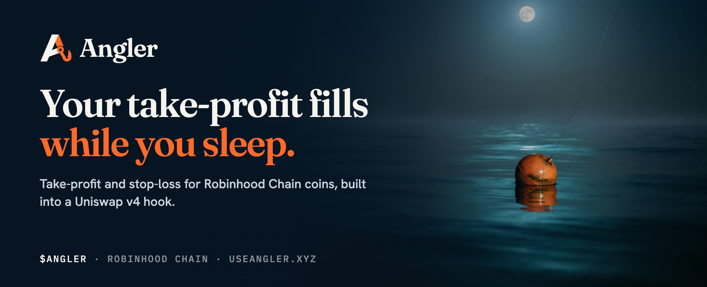

  
  
  
  
  

  <a href="https://useangler.xyz"><b>Website</b></a> ·
  <a href="https://useangler.xyz/docs"><b>Docs</b></a> ·
  <a href="https://app.useangler.xyz"><b>App</b></a> ·
  <a href="https://x.com/useangler"><b>@useangler</b></a>

---

## About

**Angler** is take-profit and stop-loss for coins on **Robinhood Chain**.

Every graduated coin on Robinhood Chain trades on Uniswap v4, and no Uniswap pool has an exit. No take-profit, no stop-loss, only whoever is awake and clicking sell. Coins run 3x overnight and give it all back by breakfast, while the people who hold them are asleep.

Angler puts the exit inside the market:

- A **take-profit** rests as one-sided liquidity in the coin's **Angler pool**, a Uniswap v4 hook. The next buyer's swap fills it at your price, and the hook pulls the filled range out inside that same swap, so it stays ETH.
- A **stop-loss** or **trailing stop** is fired by keepers, but only after the price has stayed past your floor for **30 seconds**. A one-block wick cannot sell you.
- Your coins rest in your own **Tackle Box**, a small vault that only you can withdraw from.
- Every fill is a transaction, and every fill lands in the public **Catch Log**.

> A take-profit that is liquidity does not need anyone to be awake. No server has to stay up, no key changes hands, and the fill is on chain the moment it happens.

| | |
|---|---|
| **Ticker** | `$ANGLER` |
| **Chain** | Robinhood Chain (chainId 4663) |
| **Launch** | Fair launch on the Robinhood Chain launchpad, after the product |
| **Supply** | 1,000,000,000, fixed |
| **Team allocation** | 0% |
| **Contract address** | **Not issued yet** |

> There is no `$ANGLER` contract address yet. The token opens only after real fills from wallets that are not ours are visible in the Catch Log. Until it appears on [useangler.xyz](https://useangler.xyz), any address you are shown is fake.

---

## Features

### 🌙 One night, hour by hour

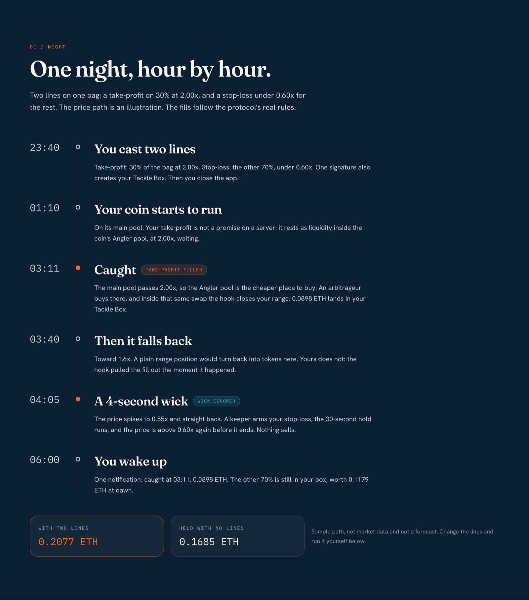

Cast two lines before bed: a take-profit on 30% of the bag at 2.00x, and a stop-loss under 0.60x for the rest. At 03:11 the take-profit fills inside a swap. At 04:05 a 4-second wick dips under the floor, the 30-second hold runs, and nothing sells. You wake up to one notification: *caught at 03:11*.

### 🎣 Two kinds of lines

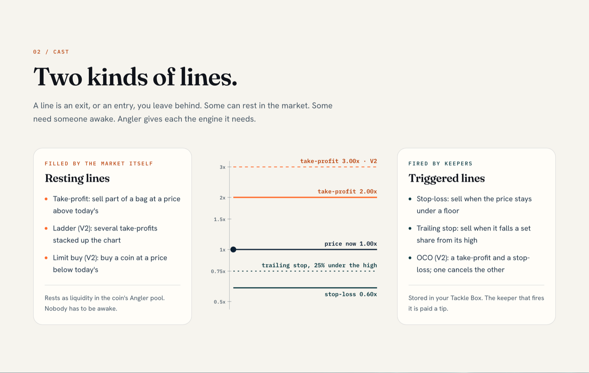

A **line** is any exit you leave behind. Angler gives each kind the engine it needs.

| Resting lines (filled by the market) | Triggered lines (fired by keepers) |
|---|---|
| **Take-profit:** sell part of a bag at a target | **Stop-loss:** sell when the price stays under a floor |
| **Ladder** (V2): several take-profits up the chart | **Trailing stop:** sell when price falls a set share from its high |
| **Limit buy** (V2): buy a coin below today's price | **OCO** (V2): a take-profit and a stop-loss, one cancels the other |

### 🪝 The take-profit fills inside the swap

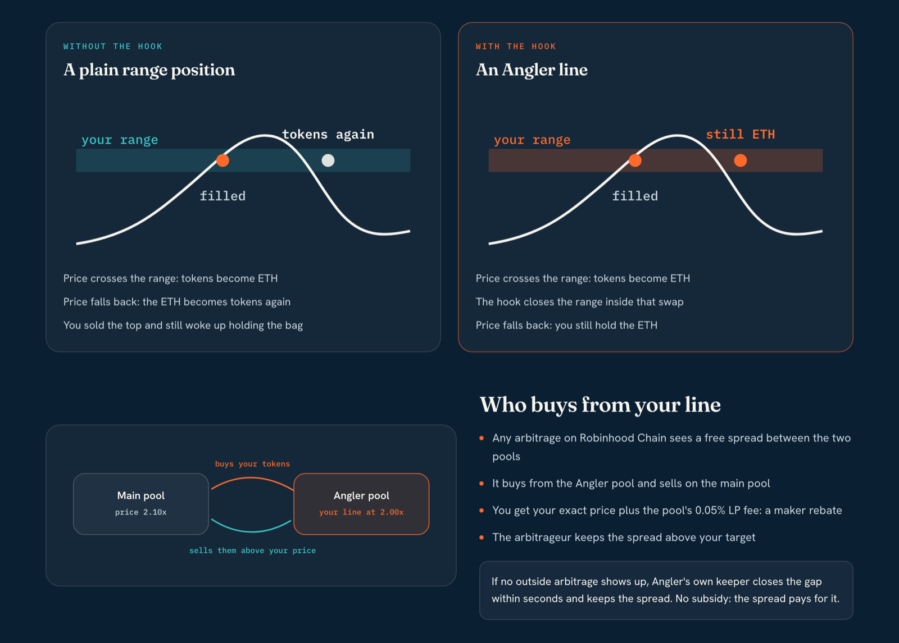

1. You pick a coin, a target and a size.
2. Your Tackle Box parks those tokens as one-sided liquidity in a narrow range at the target, inside that coin's Angler pool (coin/ETH, 0.05% fee, tick spacing 10).
3. The coin's main pool climbs past your target, so the Angler pool becomes the cheaper place to buy.
4. An arbitrageur buys from it, and that swap sells your tokens at your price.
5. The hook's `afterSwap` marks the range filled and pulls it out in the same swap. It is ETH now and stays ETH.
6. The ETH is claimable in your Tackle Box, minus the fill fee.

**Who fills it at 3am?** Arbitrage. You get your exact price plus the pool's 0.05% LP fee as a maker rebate. The arbitrage contract needs no capital and refuses any route that loses money. If no outside bot shows up, Angler's own keeper closes the gap, paid by the spread.

Orders at the same range share one **epoch**, so the hook never loops over users, and the work per swap is bounded. Anything left over is settled by the next swap or by anyone calling `settle()`.

### ⏱️ Arm, hold, fire

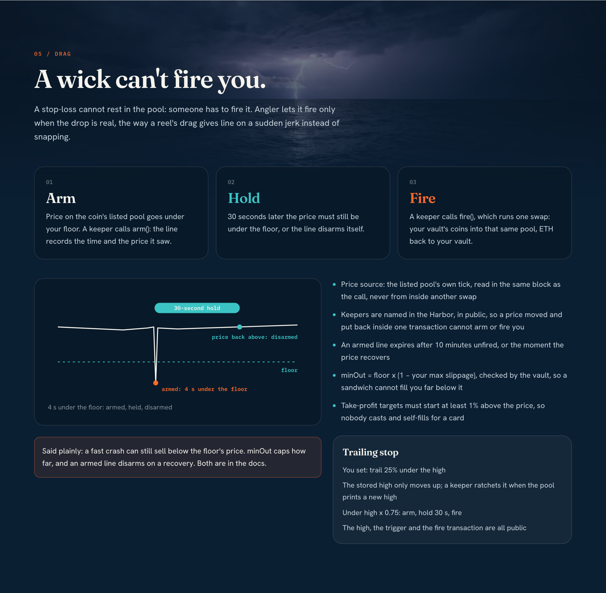

- **Arm:** price on the coin's listed pool goes under your floor. A keeper calls `arm()`, and the line records the time and the tick it saw.
- **Hold:** 30 seconds later the price must still be under the floor.
- **Fire:** a keeper calls `fire()`, which runs one swap: your coins to ETH, back to your box. An armed line expires after 10 minutes unfired.
- **minOut** = floor × (1 − your max slippage), checked by your own vault, so a sandwich cannot fill you far below it.
- **Trailing stop:** the stored high only ratchets up. When the price falls your chosen share under it, the same arm, hold and fire runs.

### 🧮 Practice cast

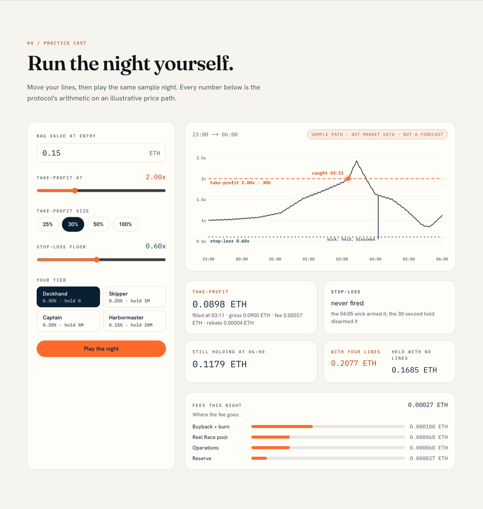

Move your lines and tier, then play the same sample night. The page shows what the take-profit returned, what the stop-loss did, what you still hold at 06:00, and where every bit of the fee goes. Sample path, not market data and not a forecast.

### 🧰 Your own Tackle Box

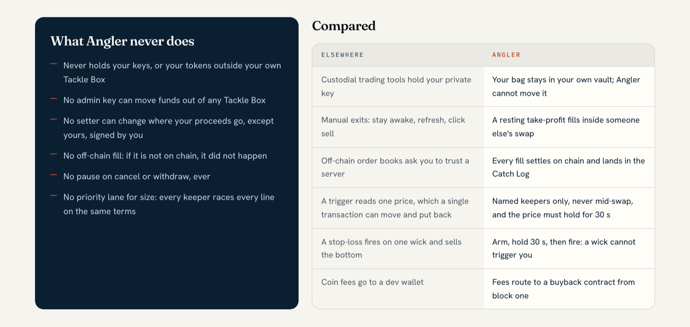

- **One vault per wallet**, an EIP-1167 clone of one fixed implementation, created in the same transaction as your first line. Its address can be computed from your wallet before it exists.
- **Only you** can cast, cancel, withdraw, and set where your proceeds go.
- **Keepers** can arm, fire and ratchet triggered lines, and anyone can claim filled ETH into your box.
- **Hard rules:** proceeds go only to the box or your forward address, one swap shape, no standing approvals.
- **Cancel any time:** coins back at once, no fee. No pause on cancel or withdraw, ever.

### 🐟 The Catch Log

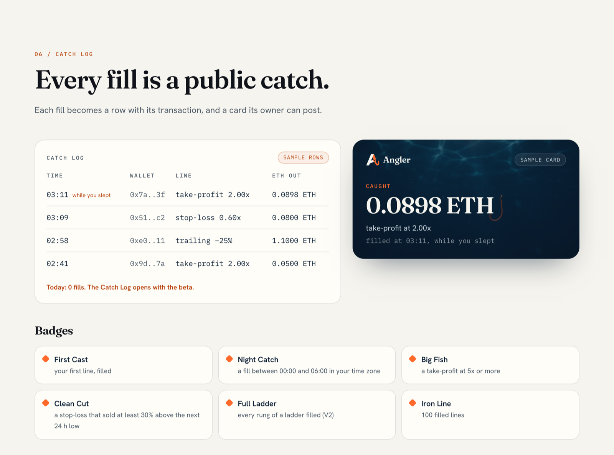

Every fill becomes a public row: coin, line type, target, size, ETH out, time and transaction link. Fills between 00:00 and 06:00 in your own time zone are tagged **while you slept**. Each fill also makes a **catch card** its owner can post.

| Badge | Earned by |
|---|---|
| **First Cast** | your first line, filled |
| **Night Catch** | a fill while you slept |
| **Big Fish** | a take-profit at 5x or more |
| **Clean Cut** | a stop-loss that sold at least 30% above the next 24 h low |
| **Full Ladder** | every rung of a ladder filled (V2) |
| **Iron Line** | 100 filled lines |

Cards only appear for fills at least 10 minutes after the cast, and take-profit targets must start above the current price, so nobody casts and self-fills for a card.

### 🏁 The Reel Race

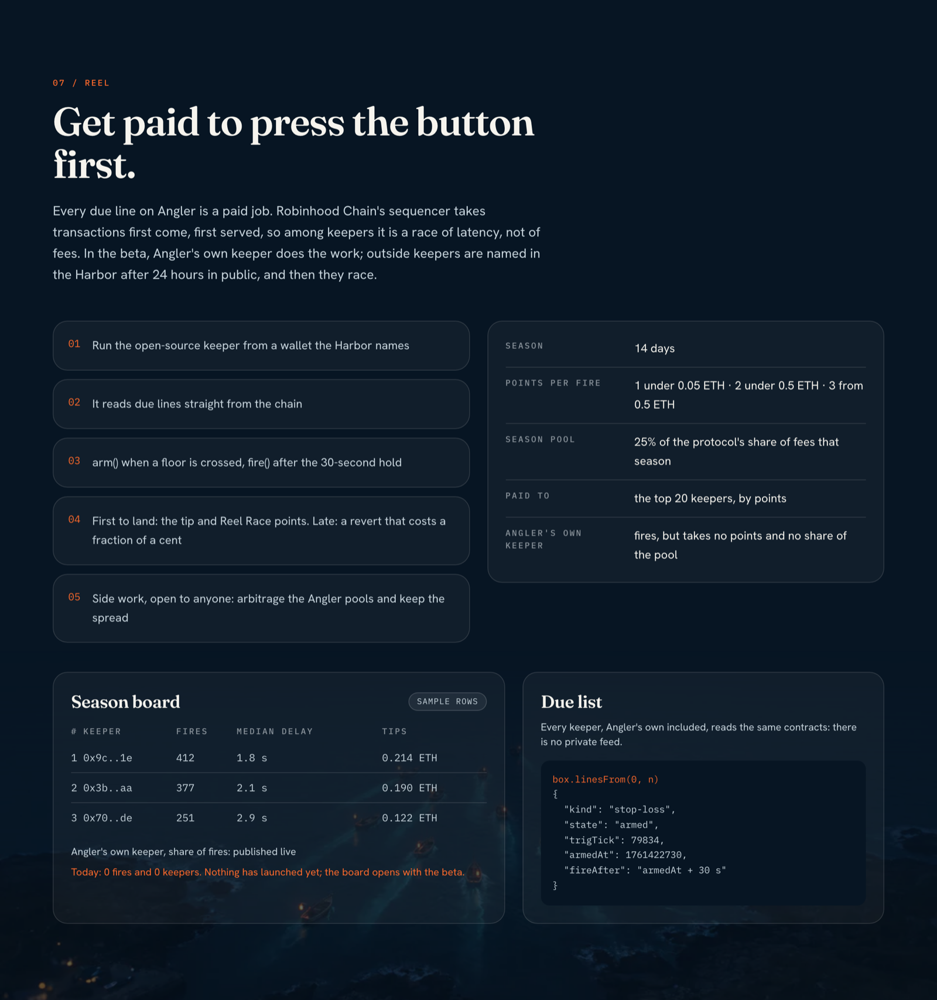

Every due stop-loss is a paid job. The first keeper to land `fire()` takes the tip, late callers revert for a fraction of a cent.

| | |
|---|---|
| **Season** | 14 days |
| **Points per fire** | 1 under 0.05 ETH · 2 under 0.5 ETH · 3 from 0.5 ETH |
| **Season pool** | 25% of the protocol's share of fees that season |
| **Paid to** | the top 20 keepers, by points |
| **Angler's own keeper** | fires, but takes no points and no share of the pool; its share of fires is published |

Fires under 0.005 ETH score nothing, points are capped at 20 per line owner per day, and wallets linked by a shared funder lose the points between them. In the beta, outside keepers are named in the Harbor after 24 hours in public, then they race on the same terms as Angler's own. There is no private feed: every keeper reads the same contracts.

### 💸 One fee, only when a line fills

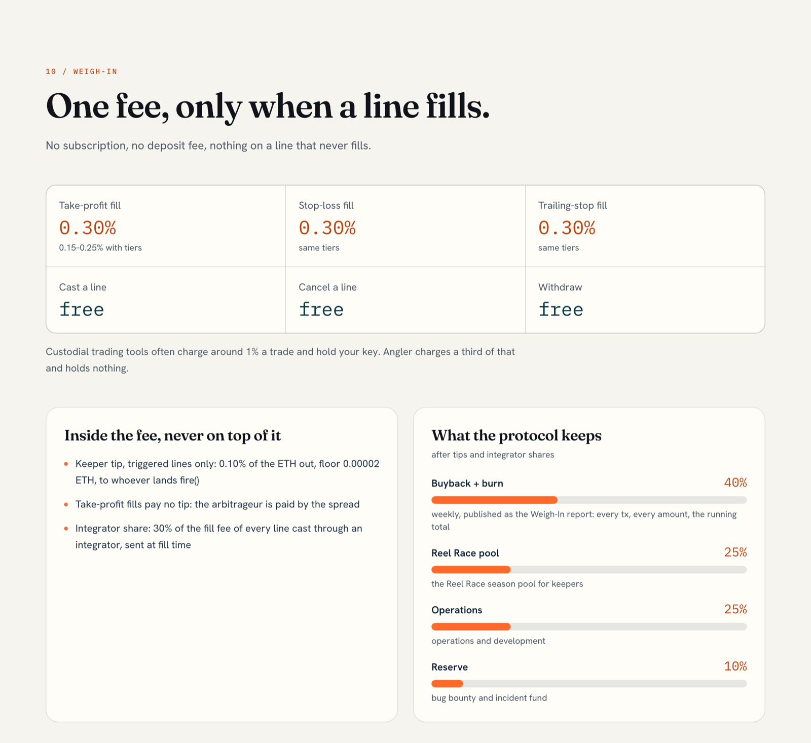

| Action | Fee |
|---|---|
| Take-profit, stop-loss or trailing-stop fill | **0.30%** of the ETH out (0.15% to 0.25% with tiers) |
| Cast, cancel, withdraw | **free** |

Out of that fee, never on top of it: a **keeper tip** of 0.10% of the ETH out (floor 0.00002 ETH) on triggered lines, and **30%** to an integrator the Harbor names when a line is cast through one. What the protocol keeps is split **40%** buyback and burn of `$ANGLER`, **25%** Reel Race season pool, **25%** operations, **10%** reserve for the bug bounty and incidents.

### 🎟️ What $ANGLER does

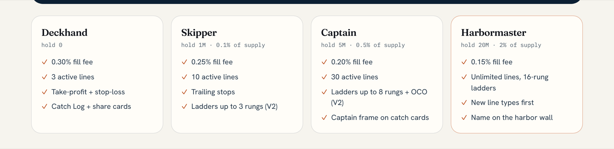

The token buys **cheaper fills and more capacity**. It never buys execution priority: every keeper races every line on the same terms.

- Your tier is your **24-hour average balance**, so a flash buy for a cheaper fill does nothing.
- The fee tier is **fixed when the line is cast**, so selling later cannot raise the fee on lines already resting.
- The launchpad's creator fee on `$ANGLER` trading goes to the **BuybackVault**, set inside the launch transaction, which buys `$ANGLER` in small chunks and burns it.

### ⚓ How the line is rigged

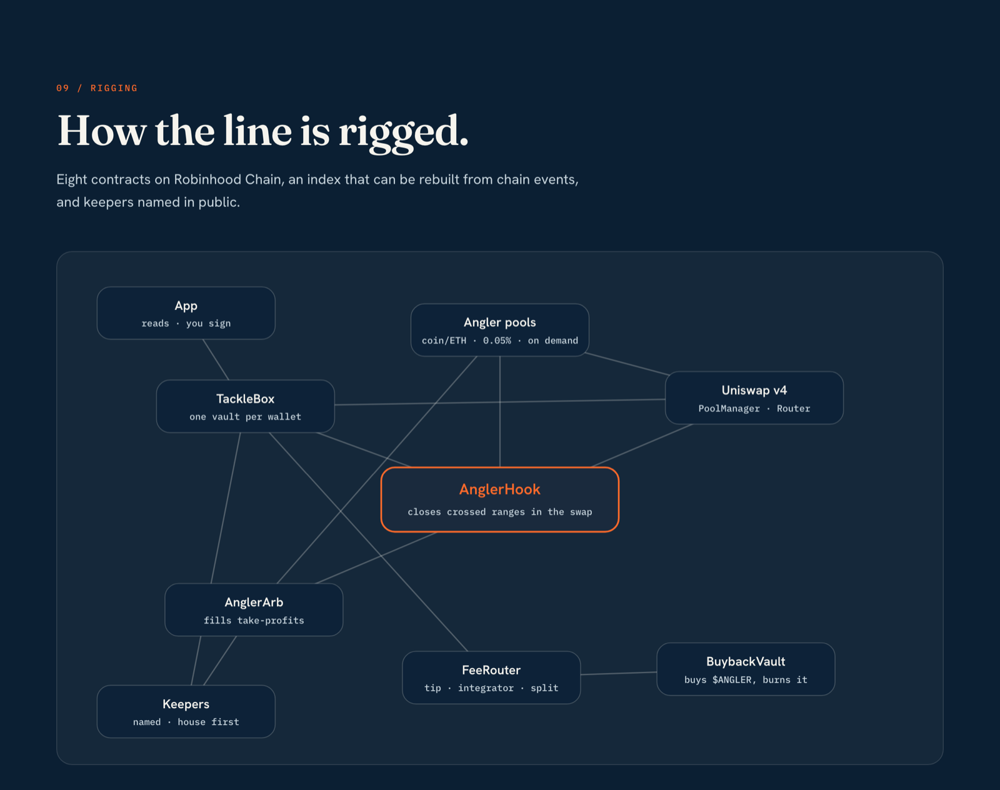

| Contract | What it does |
|---|---|
| **AnglerHook** | The Uniswap v4 hook. Opens a coin's Angler pool on its first order and closes crossed ranges in `afterSwap`. Immutable, no owner, no upgrade |
| **TackleBoxFactory** | One Tackle Box per wallet, clones of one fixed implementation |
| **TackleBox** | Your vault: rests take-profits, stores stop-losses and trailing stops, withdraws (owner only) |
| **Harbor** | The settings: beta caps, the new-pools switch, fee-tier source, named keepers, listed coins. Holds no funds |
| **FeeRouter** | Splits each fill fee: keeper tip, integrator, buyback, season pool, operations, reserve |
| **ReelRegistry** | The Catch Log and the Reel Race on chain, with seasons settled to the top 20 keepers |
| **BuybackVault** | The creator-fee recipient. Buys `$ANGLER` on Uniswap v4 and burns it |
| **AnglerArb** | Capital-free arbitrage that fills take-profits: buys from the Angler pool, sells on the main pool |

Alongside the contracts: a reference **keeper** (arm, disarm, fire, ratchet, arbitrage, settle, claim) that reads every due line in one batched call, the **app** (Tackle Box, Cast, Catch Log, Reel Race), and the **landing page and docs**.

### 📍 Deployed on Robinhood Chain

Live on mainnet since **29 October 2026** (block 26295950). Every contract's source is verified on Sourcify; each link opens the matched code.

| Contract | Address |
|---|---|
| **AnglerHook** | [`0xe1ed33343610ea9AF8B1d162f8e403FF6287e840`](https://repo.sourcify.dev/4663/0xe1ed33343610ea9AF8B1d162f8e403FF6287e840) |
| **Harbor** | [`0xFa1aa1E2BF84164b9669cF87840217D04D9039ba`](https://repo.sourcify.dev/4663/0xFa1aa1E2BF84164b9669cF87840217D04D9039ba) |
| **TackleBoxFactory** | [`0x14c64Cd1adb6A96Ae436cb772B06caaEa56282CE`](https://repo.sourcify.dev/4663/0x14c64Cd1adb6A96Ae436cb772B06caaEa56282CE) |
| **TackleBox** (implementation) | [`0xDAe553a5158f404f9264229a37eF6ad04A54E8b8`](https://repo.sourcify.dev/4663/0xDAe553a5158f404f9264229a37eF6ad04A54E8b8) |
| **FeeRouter** | [`0x4679B0B09AA2B0676bd0Caaff4Cbc0CE9E93b671`](https://repo.sourcify.dev/4663/0x4679B0B09AA2B0676bd0Caaff4Cbc0CE9E93b671) |
| **ReelRegistry** | [`0xc76744438278937637810Ac80f700Fc0EB963D00`](https://repo.sourcify.dev/4663/0xc76744438278937637810Ac80f700Fc0EB963D00) |
| **BuybackVault** | [`0xF26Bef0c07240e9F1ADf7197CdaEf4B6EEa8f10f`](https://repo.sourcify.dev/4663/0xF26Bef0c07240e9F1ADf7197CdaEf4B6EEa8f10f) |
| **AnglerArb** | [`0x40BF3E8e14EC52eB59ab06fAdec0d5434bd7d50e`](https://repo.sourcify.dev/4663/0x40BF3E8e14EC52eB59ab06fAdec0d5434bd7d50e) |
| Uniswap v4 PoolManager | `0x8366a39CC670B4001A1121B8F6A443A643e40951` |
| House keeper | `0x239cE3e5163f3456c0b81095C9c2e3A43d5A46a6` |

**Listed coins at launch:** U and GIGATENEV. More coins are listed as their main pools hold real liquidity.

### 🛡️ Safety in the beta

We would rather say this plainly:

- **Not externally audited yet.** Angler has had an internal review in two passes, plus unit, invariant and fork tests against Robinhood Chain's own PoolManager and real coin pools.
- **Beta caps:** 2 ETH per line, 25 ETH per Angler pool, 250 ETH protocol-wide, raised only after an external review is published.
- **No key can move a Tackle Box's coins.** No proxy, no upgrade path.
- **Lines only on listed coins**, each priced by its own main pool, so a pool made up for the occasion cannot price a line.
- **One owner key on the Harbor:** caps, pools, tiers, keepers and a coin's pool change only after **24 hours in public**. The **brake** stops new lines and new pools at once and never touches existing lines, cancels or withdrawals.
- **Source on Sourcify** from day one: all eight contracts are a full match, so anyone can check the bytecode against the code.

---

## Roadmap

| Phase | What ships | Status |
|---|---|---|
| **MVP** | Hook, Tackle Box and arbitrage; reference keeper; app with Tackle Box, Cast, Catch Log and Reel Race; docs and share cards; a capped mainnet beta | ✅ Live |
| **Token** | `$ANGLER` fair launch, once every launch gate is public | Next |
| **Growth** (months 1 to 3) | More graduated coins, tokenized stocks on Robinhood Chain, ladders up to 16 rungs, OCO, Reel Race season 1, web push alerts | Planned |
| **Scale** (months 3 to 6) | Limit buys, an integrator SDK with the 30% share, take-profit at graduation for launchpad buyers, an external review, caps raised in published steps | Planned |
| **Ecosystem** (months 6 to 12) | A public map of where Robinhood Chain takes profit, keeper guilds, strategy lines | Planned |

---

  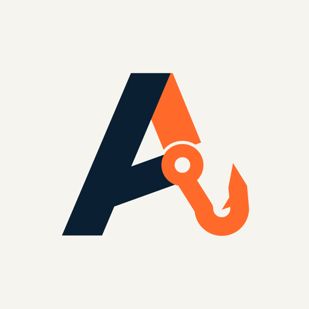 
  <b>Your take-profit fills while you sleep.</b> 
  <a href="https://useangler.xyz">useangler.xyz</a>

Angler is non-custodial beta software and has not had an external audit yet. Take-profit fills depend on market activity and arbitrage; stop-losses depend on keepers and on liquidity when they fire, and can sell below the floor in a fast crash. Smart contracts can contain bugs. Start small and verify every contract address in the docs before you sign anything. $ANGLER is a utility token for fee tiers, line capacity and new line types; it is not an investment product and carries no claim on protocol revenue. Nothing here is financial advice. Angler is a community project and is not affiliated with, endorsed by or sponsored by Robinhood, Uniswap Labs, any launchpad, wallet or exchange.
